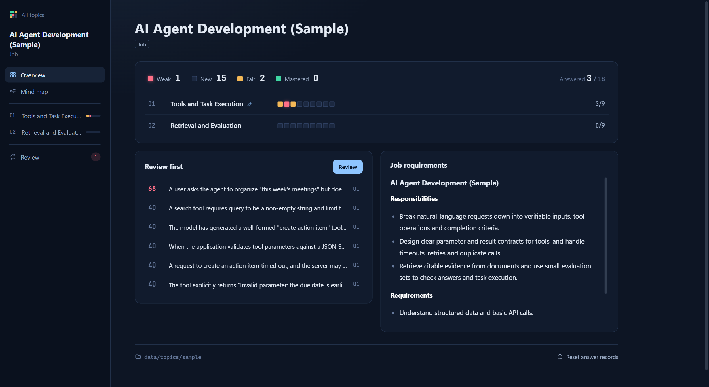

# Drillbook

<details>
<summary><b>English</b></summary>

### What it offers

A local study and review website. It runs on your own computer with no account or internet connection, and everything it stores is a plain file in this folder. The interface is in Chinese.

Content is organised into **topics**. A topic is one learning track built from one or more sources: a job description, a book, the slides or syllabus of a course, an exam outline, or a list of goals you write yourself.

- **Knowledge pages**: each topic is split into pages of knowledge points, with tables, code highlighting and formulas.
- **Quizzes**: every page has multiple-choice questions covering all of its points, and every answer is recorded. Choose “不会” (I don't know) to record an incorrect answer and avoid lucky guesses inflating your mastery.
- **Mistake review** (错题复习): all questions ranked by recent error rate. Recent and repeated mistakes come first, unanswered questions sit in the middle, and questions you always get right go last. The ⓘ button on the review page shows the formula.
- **Notes** (笔记): a Markdown notes panel on every page, saved as `.md` files you can also open in any editor.
- **Edit in place**: the 编辑 button on a knowledge page opens that page's `knowledge.md` in an editor. Saving re-parses the page, warns when a removed knowledge point still has questions, and keeps earlier versions in the page folder's `_history/`.

### Start

1. Install Python 3.8 or later (on Windows, tick "Add python.exe to PATH").
2. Double-click `start.bat`, or run `python server.py` (`python3` on macOS/Linux). Your browser opens http://127.0.0.1:8765.
3. Close the console window to stop.

### Phone app (Android)

An Android app that runs the same site offline on your phone. It pairs with this computer over Wi-Fi, without any account, and downloads your topics, answers and notes. For now, answers and notes made on the phone stay on the phone; merging them back into the computer is the next step.

1. Build the app: `python android/build.py`. It needs JDK 11 or later and the Android SDK packages `platforms;android-35` and `build-tools;35.0.1` (or later), and writes `android/build/drillbook.apk`. Rebuild after changing `web/`; new topics, answers and notes don't need a rebuild.
2. On the computer, click 连接手机 at the top right of the topic list and turn on 允许手机连接. The dialog shows this computer's address, a 6-digit pairing code and the app's download link.
3. On the phone, open the download link in the browser and install the APK, allowing the browser to install apps when asked.
4. Open Drillbook on the phone, enter the address and the pairing code, and tap 连接并下载数据. Later, tap 从电脑更新 to get new content.

The phone and the computer must be on the same Wi-Fi. School and café networks often block devices from reaching each other; connect the computer to the phone's hotspot instead. Pairing details and the app's signing key are kept in `.local/`, which is not committed. Back up `.local/android-signing.*`: an app signed with a different key can't be installed over the old one, so you would have to uninstall it and lose anything not yet merged back.

### Add a topic with an AI agent

`AGENTS.md` guides a coding agent through turning a source into knowledge points and questions: planning, overlap analysis, file formats, question quality and validation. Ask your coding agent to read it first, then provide the source.

1. Open this folder in your agent and start a new session.
2. Send the source, for example:

   ```text
   Follow AGENTS.md and add this job:
   (paste the job description: title, company, responsibilities, requirements)
   ```

   ```text
   Follow AGENTS.md and add this book: Computer Systems: A Programmer's Perspective, 3rd edition, chapters 1–9. I'm preparing for an exam.
   ```

   ```text
   Follow AGENTS.md and turn these lecture slides into a topic:
   (attach the slides, or paste the syllabus)
   ```

   You can also mention the level or purpose (interview, exam, self-study), the areas to focus on, or that you want the content in English.
3. The agent compares the source with the topics already here. If a similar topic exists (a related role, another edition of the same book, the same course), it shows you the overlap and asks whether to merge into that topic or create a new one. If you already know where the content should go, say so in the request and it will not ask.
4. Refresh the browser to see the new pages.

### Your data

| Folder | Contents |
| --- | --- |
| `data/topics/` | Topics, pages, knowledge points and questions (format described in `AGENTS.md`) |
| `data/records/` | Your answers, one line per answer |
| `data/notes/` | Your notes, one `.md` file per page; older versions in `_history/` |

To back up, copy `data/`. The 重置作答记录 (reset answers) link at the bottom of a topic's overview moves old records to `data/records/archive/` instead of deleting them.

Only `data/topics/sample/` is included in Git. Other topic folders, all answer history and all notes are excluded by `.gitignore`, so they stay local when you commit or push. Generate personal content in a new topic folder rather than replacing Sample with private information. Back up your local data separately.

### Keys

| Key | Action |
| --- | --- |
| `A`–`H` or `1`–`8` | Choose an option |
| `0` | Choose “不会” (I don't know) |
| `Enter` | Submit, then go to the next question |
| `←` `→` | Previous / next question |
| `Ctrl+S` | Save notes, or the knowledge file being edited |
| `Esc` twice | Close the notes panel |

### Commands

```text
python server.py --check      Check the question bank for format problems
python server.py --outline    List every topic, page and knowledge point
python server.py --port 9000  Use a different port
```

</details>

<details>
<summary><b>简体中文</b></summary>

### 网站提供什么

一个在本机运行的学习复习网站：不需要账号，不需要联网，存下来的所有东西都是这个文件夹里的普通文件。

内容按**专题**组织。一个专题是一条学习路线，由一份或几份来源生成：一个岗位的 JD、一本书、一门课的课件或大纲、一份考试大纲，或者你自己列的学习目标。

- **知识点**：每个专题分成若干页面，每页若干知识点，支持表格、代码高亮和公式。
- **选择题**：每页的题目覆盖本页全部知识点，每次作答都会记录。选择「不会」按答错记录，避免蒙对影响掌握度。
- **错题复习**：全部题目按近期错误率排序。最近错的、反复错的排在最前，没做过的在中间，一直答对的在最后。复习页的 ⓘ 按钮里有排序公式。
- **笔记**：每页一个 Markdown 笔记面板，自动保存成 `.md` 文件，也可以用任何编辑器打开。
- **页内编辑**：知识点页右上角的「编辑」直接修改这一页的 `knowledge.md`。保存后按新内容重新解析，删掉了仍有题目关联的知识点会提示，旧版本保留在页面文件夹的 `_history/`。

### 启动

1. 安装 Python 3.8 或更高版本（Windows 上勾选 “Add python.exe to PATH”）。
2. 双击 `start.bat`，或运行 `python server.py`（macOS / Linux 用 `python3`）。浏览器会打开 http://127.0.0.1:8765 。
3. 关闭控制台窗口即停止。

### 手机版（安卓）

一个安卓 App，在手机上离线运行同一个网站。它通过 Wi-Fi 和这台电脑配对（不需要任何账号），下载专题、作答记录和笔记。目前手机上做的题和写的笔记先留在手机上，合并回电脑是下一步要做的。

1. 打包 App：运行 `python android/build.py`。需要 JDK 11 或更高版本，以及 Android SDK 的 `platforms;android-35` 和 `build-tools;35.0.1`（或更高）；输出 `android/build/drillbook.apk`。改了 `web/` 之后要重新打包；新增专题、作答记录和笔记不用。
2. 在电脑上点专题列表右上角的「连接手机」，打开「允许手机连接」。对话框里会显示这台电脑的地址、6 位配对码和 App 的下载地址。
3. 用手机浏览器打开下载地址，安装 APK；按提示允许浏览器安装应用。
4. 在手机上打开 Drillbook，填电脑地址和配对码，点「连接并下载数据」。之后点「从电脑更新」获取新内容。

手机和电脑要连同一个 Wi-Fi。学校、咖啡店的网络一般不允许设备之间互连，这时让电脑连手机热点。配对信息和 App 的签名密钥保存在 `.local/`，不进 git。请备份 `.local/android-signing.*`：换了密钥签名的 App 不能覆盖安装旧版，只能卸载重装，手机上还没合并回电脑的内容会丢失。

### 让 AI agent 生成专题

`AGENTS.md` 可以指导 coding agent 把一份来源变成知识点和题目，包含规划、重叠分析、文件格式、出题标准和校验流程。让 coding agent 先读取这个文件，再把来源发给它即可。

1. 用 agent 打开这个文件夹，新开一个会话。
2. 把来源发给它，例如：

   ```text
   按 AGENTS.md 把这个岗位加入题库：
   （粘贴 JD：岗位名、公司、职责、任职要求）
   ```

   ```text
   按 AGENTS.md 把这本书做成专题：《深入理解计算机系统》第 3 版，第 1–9 章，用来准备期末考试。
   ```

   ```text
   按 AGENTS.md 把这门课的课件做成专题：
   （附上课件文件，或粘贴课程大纲）
   ```

   还可以补充级别或目的（面试、考试、自学）、想侧重的方向，或者要英文内容。
3. agent 会先和已有专题比对。发现同类专题（相近的岗位、同一本书的另一个版本、同一门课）时，它会把重叠情况告诉你，由你决定合并进去还是新建一个专题；如果你一开始就说明了放在哪里，它不会再问。
4. 完成后刷新浏览器即可看到新页面。

### 数据在哪

| 文件夹 | 内容 |
| --- | --- |
| `data/topics/` | 专题、页面、知识点、题目（格式见 `AGENTS.md`） |
| `data/records/` | 作答记录，每答一题一行 |
| `data/notes/` | 笔记，每页一个 `.md` 文件；旧版本在 `_history/` |

备份就复制整个 `data/`。专题总览页底部的「重置作答记录」会把旧记录移到 `data/records/archive/`，不会删除。

Git 只收录 `data/topics/sample/`。其他专题目录、全部作答记录和笔记都通过 `.gitignore` 排除，提交和推送时仍留在本地。个人内容请写到新的专题目录，不要用私人资料覆盖 Sample；本地数据需单独备份。

### 快捷键

| 按键 | 作用 |
| --- | --- |
| `A`–`H` 或 `1`–`8` | 选择选项 |
| `0` | 选择「不会」 |
| `Enter` | 提交，再按一次进入下一题 |
| `←` `→` | 上一题 / 下一题 |
| `Ctrl+S` | 立即保存笔记，或正在编辑的知识点文件 |
| 按两次 `Esc` | 关闭笔记面板 |

### 命令

```text
python server.py --check      检查题库格式
python server.py --outline    列出所有专题、页面和知识点
python server.py --port 9000  换一个端口
```

</details>

## 界面预览 / Screenshots

### 专题总览



### 知识点与笔记


### 错题复习


