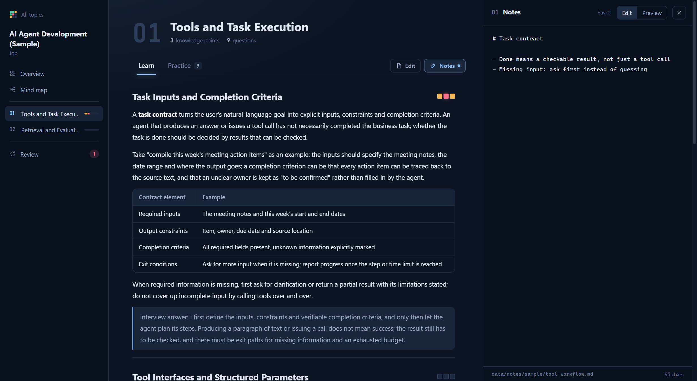
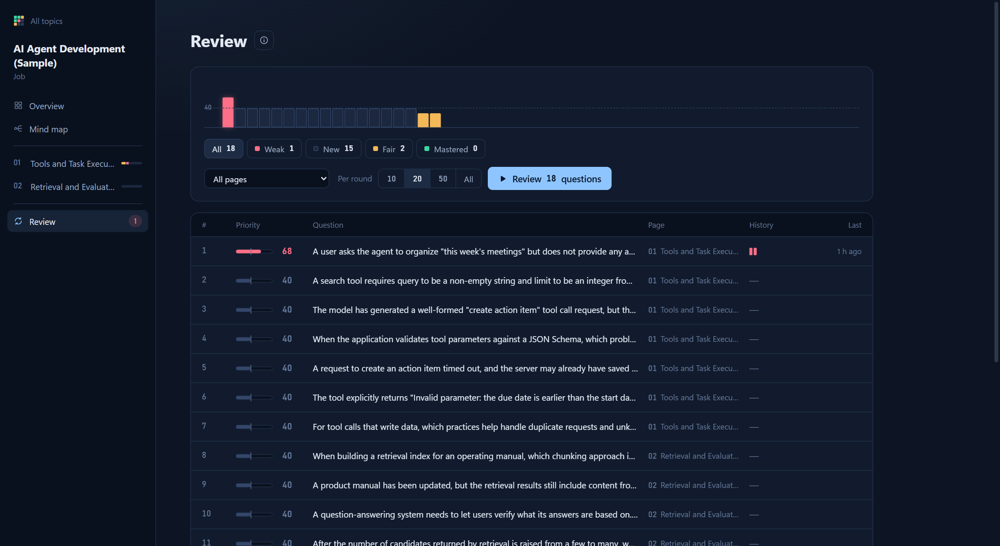

# Drillbook

### What it offers

A local study and review website. It runs on your own computer with no account or internet connection, and everything it stores is a plain file in this folder.

Content is organized into **topics**. A topic is one learning track built from one or more sources: a job description, a book, the slides or syllabus of a course, an exam outline, or a list of goals you write yourself.

- **Knowledge pages**: each topic is split into pages of knowledge points, with tables, code highlighting and formulas.
- **Mind map** (in the sidebar under Overview): a collapsible map of the whole topic — theme groups, pages, knowledge points and the key details of each point — with every page and point colored by how well you know it. Click a node to expand it; its arrow opens the full text. Narrow screens get an indented outline instead (switch with Map / Outline). The map is written in the topic's `mindmap.md`.
- **Practice**: every page has multiple-choice questions covering all of its knowledge points, and every answer is recorded. Choose "Don't know" to record an incorrect answer, so lucky guesses don't inflate your mastery.
- **Review**: all questions ranked by recent error rate. Recent and repeated mistakes come first, unanswered questions sit in the middle, and questions you always get right go last. The ⓘ button on the Review page shows the formula.
- **Notes**: a Markdown notes panel on every page, saved as `.md` files that you can also open in any editor.
- **Edit in place**: the Edit button on a knowledge page opens that page's `knowledge.md` in an editor. Saving re-parses the page, warns when a removed knowledge point still has questions, and keeps earlier versions in the page folder's `_history/`.
- **Topic order**: drag a topic in the topic list to a new place (on the phone, press and hold it first), or focus it and press Alt+↑ / Alt+↓. The order is saved as `order` in each topic's `topic.json`.

### Start

1. Install Python 3.8 or later (on Windows, tick "Add python.exe to PATH").
2. Double-click `start.bat`, or run `python server.py` (`python3` on macOS/Linux). Your browser opens http://127.0.0.1:8765.
3. Close the console window to stop.

### Phone app (Android)

An Android app that runs the same site offline on your phone and syncs with this computer over Wi-Fi, without any account. Practice anywhere; when the phone can reach the computer, both sides end up with the same topics, answers and notes.

1. **Build the app (once).** The repository doesn't include the APK, so the download link in step 2 only works after you build it. No account is needed.
   1. Install JDK 17 or later, for example [Eclipse Temurin](https://adoptium.net/).
   2. From [developer.android.com/studio](https://developer.android.com/studio), download "Command line tools only" and unzip it so that its `bin` folder ends up at `%LOCALAPPDATA%\Android\Sdk\cmdline-tools\latest\bin` (macOS: `~/Library/Android/sdk/cmdline-tools/latest/bin`, Linux: `~/Android/Sdk/cmdline-tools/latest/bin`; to use another folder, set `ANDROID_HOME` to it).
   3. Install the two packages the build needs, typing `y` when asked to accept the license:

      ```text
      %LOCALAPPDATA%\Android\Sdk\cmdline-tools\latest\bin\sdkmanager "platforms;android-35" "build-tools;35.0.1"
      ```

   4. In this folder, run `python android/build.py`. It creates `android/build/drillbook.apk`.

   Run step 4 again after updating the code. New topics, answers and notes don't need a rebuild.
2. On the computer, click "Connect phone" at the top right of the topic list and turn on "Allow phone connections". The dialog shows this computer's address, a 6-digit pairing code and the app's download link.
3. On the phone, open the download link in the browser and install the APK, allowing the browser to install apps when asked.
4. Open Drillbook on the phone, enter the computer address and the pairing code, and tap "Connect and sync".

The app syncs by itself when you open it, when you come back to it and before you leave it, and every few minutes while there are unsynced changes; "Sync now" syncs on demand. If it can't reach the computer, it keeps your changes and tries again later. How the two sides are merged:

- **Answers** from both sides are combined; nothing is overwritten.
- **Notes**: if only one side changed a note, that version is used. If both changed it, the more recent edit wins and the other version is saved in the computer's `data/notes/<topic>/_history/<page>/` (file name ending in `-phone` or `-pc`); the app tells you when this happens.
- **Resetting a topic's answers** on either side resets it on both after the next sync. The computer moves its old answers to `data/records/archive/`.
- **Topic order**: if only one side reordered the topics, that order is used. If both did, the more recent one wins and the app tells you.
- **Knowledge pages** are edited on the computer only; the app shows them read-only.

The phone and the computer must be on the same Wi-Fi. School and café networks often block devices from reaching each other; connect the computer to the phone's hotspot instead. After pairing, the phone signs each sync request instead of sending its token, so a request captured on the Wi-Fi can't be replayed. Pairing details and the app's signing key are kept in `.local/`, which is not committed. Back up `.local/android-signing.*`: an app signed with a different key can't be installed over the old one, so you would have to uninstall it and lose anything not yet synced.

### Add a topic with an AI agent

`AGENTS.md` guides a coding agent through turning a source into knowledge points, questions and a mind map: planning, overlap analysis, file formats, question quality and validation. Ask your coding agent to read it first, then provide the source.

1. Open this folder in your agent and start a new session.
2. Send the source, for example:

   ```text
   Follow AGENTS.md and add this job:
   (paste the job description: title, company, responsibilities, requirements)
   ```

   ```text
   Follow AGENTS.md and add this book: Computer Systems: A Programmer's Perspective, 3rd edition, chapters 1–9. I'm preparing for an exam.
   ```

   ```text
   Follow AGENTS.md and turn these lecture slides into a topic:
   (attach the slides, or paste the syllabus)
   ```

   You can also mention the level or purpose (interview, exam, self-study) and the areas to focus on. The content is written in the language of your request; if that isn't English, every core term gets its English name in parentheses. To add a mind map to a topic that doesn't have one yet: `Follow AGENTS.md and write the mind map for the topic (topic name)`.
3. The agent compares the source with the topics already here. If a similar topic exists (a related role, another edition of the same book, the same course), it shows you the overlap and asks whether to merge into that topic or create a new one. If you already know where the content should go, say so in the request and it will not ask.
4. Refresh the browser to see the new pages.

### Your data

| Folder | Contents |
| --- | --- |
| `data/topics/` | Topics, pages, knowledge points and questions (format described in `AGENTS.md`) |
| `data/records/` | Your answers, one line per answer; `resets.json` notes when each topic's answers were last reset |
| `data/notes/` | Your notes, one `.md` file per page; older versions in `_history/` |

To back up, copy `data/`. The "Reset answer records" link at the bottom of a topic's overview moves old records to `data/records/archive/` instead of deleting them.

Only `data/topics/sample/` is included in Git. Other topic folders, all answer history and all notes are excluded by `.gitignore`, so they stay local when you commit or push. Generate personal content in a new topic folder rather than replacing Sample with private information. Back up your local data separately.

### Keys

| Key | Action |
| --- | --- |
| `A`–`H` or `1`–`8` | Choose an option |
| `0` | Choose "Don't know" |
| `Enter` | Submit, then go to the next question |
| `←` `→` | Previous / next question |
| `Ctrl+S` | Save notes, or the knowledge file being edited |
| `Esc` twice | Close the notes panel |

### Commands

```text
python server.py --check      Check the question bank for format problems
python server.py --outline    List every topic, page and knowledge point
python server.py --port 9000  Use a different port
```

## Screenshots

### Topic overview


### Knowledge points and notes



### Review


